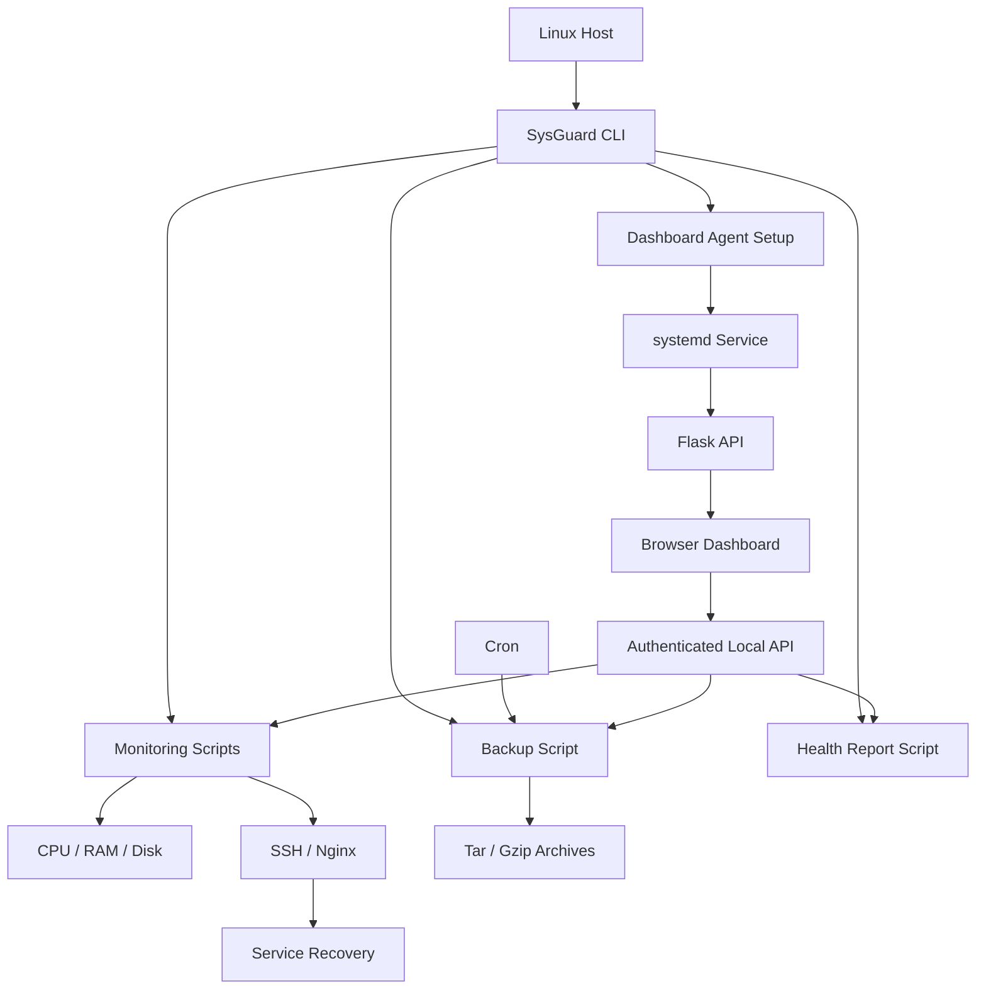

# SysGuard Architecture

## 1. Overview

SysGuard combines Bash-based Linux monitoring and automation with an optional Flask dashboard agent.

The project has two operating layers:

1. Linux automation scripts that perform monitoring, recovery, backup, and reporting.
2. A local dashboard agent that exposes authenticated system information and approved operations to the browser.

## 2. Architecture

## 3. Main components

| Component | Responsibility |
|---|---|
| `sysguard` | User-facing command-line interface |
| `install.sh` | Installs the CLI command |
| `scripts/sysguard.sh` | Monitors resources and services |
| `scripts/backup.sh` | Creates compressed project backups |
| `scripts/health-report.sh` | Generates system health reports |
| `scripts/agent-pair` | Generates one-time browser pairing codes |
| `config/sysguard.conf` | Monitoring and backup configuration |
| `dashboard/agent/app.py` | Flask API and authenticated operations |
| `dashboard/web/` | Browser dashboard |
| `dashboard/agent/publish_snapshot.py` | Publishes a read-only dashboard snapshot |
| systemd | Runs the local dashboard agent |
| Cron | Schedules backups |
| Logrotate | Rotates application logs |

## 4. Authentication and browser pairing

The dashboard agent uses local browser pairing.

1. The user runs `sysguard agent pair`.
2. A cryptographically random, single-use code is generated.
3. The code expires after five minutes.
4. The browser submits the code to the local pairing endpoint.
5. The backend validates the code and creates an authenticated browser session.
6. The pairing file is deleted after successful use.

The API is configured to listen on localhost. The dashboard agent should not be exposed directly to the public internet.

## 5. Dashboard operating modes

### Local mode

The local browser connects to the user's own Linux agent. Authenticated API requests retrieve live information and can execute approved SysGuard operations.

### Public snapshot mode

A static published snapshot can be displayed by a public website. It is read-only and cannot execute commands on a visitor's computer.

A public GitHub Pages deployment and a local Linux agent serve different purposes.

## 6. Monitoring workflow

1. Load the SysGuard configuration.
2. Measure CPU utilization.
3. Calculate memory utilization.
4. Inspect filesystem usage.
5. Check configured services.
6. Attempt recovery if a monitored service is inactive.
7. Record monitoring activity in logs.

## 7. Backup workflow

1. Cron or the user starts the backup script.
2. The script creates a timestamped compressed archive of the SysGuard project.
3. Archives older than the configured retention period are removed.
4. Backup activity is logged.

**Current scope:** the backup script archives the SysGuard project directory. The configured `BACKUP_SOURCES` entries are not currently included in the archive.

## 8. Security considerations

- Local API binding uses loopback.
- Browser pairing codes are single-use and time-limited.
- API and session secrets are stored outside the Git repository.
- The dashboard uses authenticated sessions for browser operations.
- Service restart operations are restricted to configured services.
- The dashboard does not provide an unrestricted shell endpoint.

## 9. Platform notes

The project is developed and tested on Ubuntu under WSL2. systemd services and cron jobs require the WSL distribution to be running.
