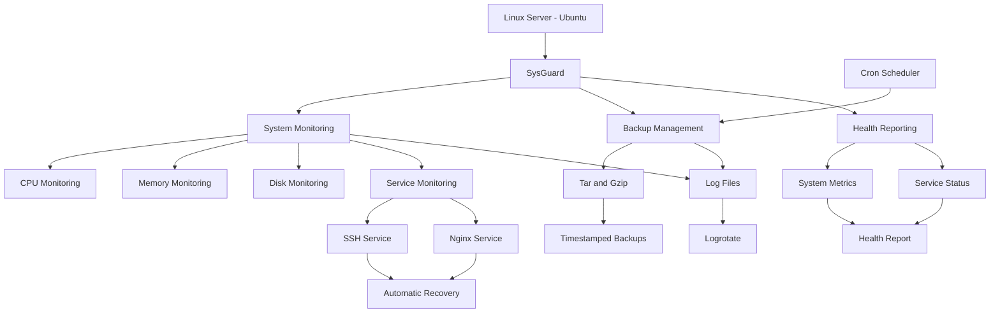

# SysGuard – System Architecture

## 1. Overview

SysGuard is a Bash-based Linux server monitoring and automation tool. It monitors system resources, checks critical services, attempts automatic service recovery, manages backups, and generates health reports.

## 2. Architecture Diagram

## 3. Main Components

| Component | Responsibility |
|---|---|
| sysguard.sh | Monitors CPU, RAM, disk and services |
| backup.sh | Creates compressed project backups |
| health-report.sh | Generates system health reports |
| sysguard.conf | Stores monitoring thresholds and settings |
| Cron | Schedules automated backups |
| Logrotate | Rotates and manages log files |
| systemd | Checks and restarts Linux services |

## 4. Monitoring Workflow

1. SysGuard loads its configuration.
2. CPU utilization is measured.
3. Memory utilization is calculated.
4. Disk usage is checked against configured thresholds.
5. SSH and Nginx service states are checked.
6. If a monitored service is inactive, SysGuard attempts to restart it.
7. Monitoring activities are recorded in log files.

## 5. Backup Workflow

1. Cron triggers the backup script at the scheduled time.
2. The script creates a timestamped compressed archive of the SysGuard project.
3. Existing backup archives are retained according to the configured retention period.
4. Older archives are deleted.

**Note:** The current backup script archives the SysGuard project itself. It does not yet back up `/var/log` or `/var/www/html`.

## 6. Technology Stack

- Ubuntu Linux
- Bash Shell Scripting
- systemd
- Cron
- Logrotate
- Tar and Gzip
- Git and GitHub

## 7. Future Enhancements

- AWS S3 backup integration
- Email alert notifications
- HTML health reports
- Prometheus and Grafana monitoring
- Docker deployment
